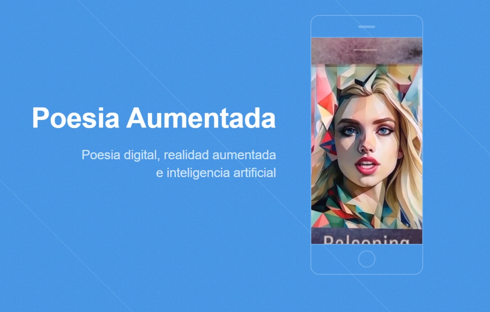

# Poesia Aumentada



**Poesia Aumentada** is a digital poetry project that combines literature,
animation, augmented reality, and artificial intelligence. It gives poems a
visual and interactive dimension, connecting one of the oldest art forms with
new technologies.

Visit the live project at [poesiaumentada.com](https://poesiaumentada.com/).

## What is included

- A static landing page for the project.
- Augmented-reality experiences for individual poems and artists.
- Image-target tracking that starts animated video experiences on compatible
  mobile devices.
- Artwork, videos, and reusable front-end assets in the `assets/` directory.

## Project structure

```text
.
├── index.html              # Main project website
├── assets/
│   ├── images/              # Artwork, logos, and image-target source files
│   ├── videos/              # AR experience videos
│   ├── css/                # Compiled stylesheets
│   └── js/                 # Website scripts
└── ar/
    ├── grethel/             # Grethel AR experience
    └── pimentel/            # Pimentel AR experience
```

## Run the website locally

The main site is a static website. Serve the repository root with any static
file server so that root-relative asset paths work correctly. For example:

```bash
python -m http.server 8000
```

Then open <http://localhost:8000> in a browser.

## Develop an AR experience

Each AR project is an independent webpack application:

```bash
cd ar/grethel
npm install
npm run serve
```

Use the same commands from `ar/pimentel` to work on that experience. Create a
production bundle with:

```bash
npm run build
```

## Create image targets

The image-target CLI is maintained in the 8th Wall tools repository:

```text
8th wall repos/8thwall-main/apps/image-target-cli
```

1. Run the CLI from that directory:

    ```bash
    npx image-target-cli
    ```

2. Provide the path to the image file, not just its containing directory.
3. Use a source image of at least **480 × 640 pixels**. Resize images larger
   than **2048 pixels** on either side before processing.
4. Copy the generated target files from the `out` directory into the relevant
   AR project.
5. Add a play button to the target thumbnail when required.
6. Register the target in that project's `app.js` and `index.html`.
7. Keep target names, image filenames, video IDs, and HTML references
   consistent.

Example target markup:

```html
<xrextras-named-image-target name="sigue_rondando_la_sombra">
    <xrextras-target-video-sound
        video="#sigue_rondando_la_sombra"
        thumb="#sigue_rondando_la_sombra"
        height="1.34"
        width="1"
    ></xrextras-target-video-sound>
</xrextras-named-image-target>
```

After adding a target, build the relevant AR project so the generated source
is ready for deployment.

## Roadmap

- [ ] Preload CSS and JavaScript files.
- [ ] Minify production assets.
- [ ] Configure AWS hosting with S3, CloudFront, and a hosted zone.
- [ ] Add a contact Lambda.
- [ ] Add Cloudflare Turnstile.
- [ ] Continue expanding 8th Wall experiences.
